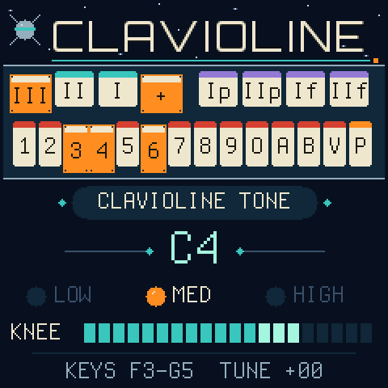

# CLAVIOLINE for the M-VAVE FM-1



Custom firmware that turns the FM-1 into a **Clavioline**, the valve keyboard Constant Martin invented in 1947 and
Selmer built in England in the 1950s. It is the reedy, vibrato-laden lead voice of records like "Telstar".

The Clavioline plays one note at a time. Inside, a valve oscillator makes a single bright, buzzy tone, and everything
else is about shaping that tone:
- a row of **tablets** (stop switches) along the front changes the tone colour;
- a **knee lever** under the keyboard swells the volume, played with the knee while both hands are on the keys;
- a three-speed **vibrato**;
- on the **Concert** model, **sub-octaves** that add one or two octaves below the note.

### How faithful it is

The firmware is built from the original circuit diagrams. The diagrams were traced wire by wire into a computer model of the circuit. That model was then solved on a PC for all 8,192 tablet combinations, and the FM-1 plays back the result: compact filters that reproduce what the circuit does for each combination. The FM-1's small processor could not run the full circuit live, but this way the tablets still interact exactly as the model says.

Some parts of the original are not in any known surviving document: the coils' values, the oscillator's exact wave shape,
the amount of amplifier distortion and the speaker's sound. Those are estimates, refined by comparing the firmware
against a recording of a real Clavioline.

## Playing

The Clavioline plays **one note at a time**. When you hold several keys, the **highest** one sounds, as on the original.
Sliding from key to key without letting go changes the pitch without starting a new note. Every new note after
silence starts the same way.

### PLAY mode

| Control | What it does | On the original |
|---|---|---|
| Keys | Play | The 36-key keyboard, F to E |
| GLO | STOPS mode: all the tablets, including vibrato, P and the sub-octaves | The tablet rail |
| **PRESETS** knob | **Knee lever**: the expression swell. Turn quickly for big moves, slowly for small ones. Fully left is silent. MIDI CC 11 moves it too | The lever under the keyboard, pushed with the knee |
| MASTER | Volume | The amplifier |
| OCT− / OCT+ | Octave coupler: LOW / MED / HIGH | The transposing slider |
| ALGORITHM | Shift the FM-1's 27 keys up an octave to reach the top of the 36-key range (back to F3–G5 at power-on) | |
| SELECT | Presets (see below) | The voicing card |
| SAVE | Store the current tablets and coupler in the user slot shown | |
| SEQ | Options: pluck decay, knee lever speed, portamento (see below) | |
| KNOB 1 | Fine tuning | The tuning control |

### The tablets

Most tablets switch capacitors and resistors into a single network of coils that sits between the oscillator and the
amplifier. Because it is one shared circuit, the tablets do not simply add up: each changes what the others do. That
is why a short list of switches could imitate violins, oboes, trumpets and organs.

| Tablet | What it does in the circuit | What you hear |
|---|---|---|
| **1, 2** | Capacitors across the coil chain; 2 tunes exactly an octave above 1 | A strong resonance (formant), low or higher |
| **3, 4** | Capacitors with resistors; 9.5 semitones apart | Softer, broader formants |
| **5, 6** | Capacitors on a second winding of the same coil | Colour that appears only alongside other tablets |
| **7, 8, 9** | Capacitors that bridge round the coils, 9 the largest | More of the upper harmonics get through: brighter, more cutting |
| **O** | A resistor across the last coil | Damps the resonances: smoother, rounder |
| **A** | A capacitor from the middle of the coil chain to ground | Cuts upper harmonics part-way along |
| **B** | Grounds the middle of the coil chain | Only the thin bypass path is left: a thin, reedy tone (A no longer has any effect) |
| **V** | A capacitor at the network's input | Darkens the upper harmonics: a gentler alternative to O |
| **P** | Shortens the control valve's delay | Each note starts with a sharp, percussive peak instead of swelling in |
| **Vibrato I, II, III** | The vibrato oscillator's speed: 4.5, 5.5 or 6.5 Hz | |
| **Amplitude** | Vibrato depth | Shallow or deep vibrato |
| **Sub I, Sub II** (Concert) | Divider valves, each soft (**p**) or loud (**f**) | The octave and the two octaves below |

### STOPS mode: the tablets

Press **GLO** and the keyboard becomes the row of tablets. Each key turns one on or off, and its LED shows which are
down. **GLO** or **HOME** goes back to playing.

To hear the tablets while you set them:
- **FX, SEL, ENV, LFO, EDIT** play **C4, D4, E4, F4, G4** for as long as you hold them; their lights glow in STOPS mode.
- **PLAY** holds the last note as a drone.

```
 black keys:    F#3  G#3  A#3   C#4                         A#4   C#5   D#5   F#5
                vib  vib  vib   vibrato                     Sub   Sub   Sub   Sub
                III  II   I     depth (+)                   I p   II p  I f   II f
 white keys: F3  G3  A3  B3  C4  D4  E4  F4  G4  A4  B4  C5  D5  E5  F5
              1   2   3   4   5   6   7   8   9   O   A   B   V   P
```

### Options

**SEQ** opens a page of settings that the original did not have. **SELECT** chooses one, **KNOB 1** changes it, and
**SEQ** goes back.
- **PLUCK DECAY** (off at every power-on; 0.3, 0.6, 1.2 or 2.5 s): every key press starts at full level and fades away.
  On the original, the player made this by flicking the knee lever back, which is awkward on the PRESETS knob.
- **DECAY ON**: only on notes with tablet **P** down, or on all notes.
- **KNEE SPEED** (FINE, GENTLE, NORMAL, FAST, VERY FAST; NORMAL to start with): how far each click of the PRESETS
  knob moves the knee lever. FINE is one step per click however fast you turn, for slow, even swells; the faster
  settings cover the lever's range in fewer turns.
- **PORTAMENTO** (off at every power-on; 15, 30, 60, 120, 250 or 500 ms): each new note glides from the last one's pitch.
  After a silence a note starts at its own pitch.

### Presets

**SELECT** steps through 40 voicings in alphabetical order, then 4 user slots. The instrument always starts on
**Clavioline Tone**; your user slots and options are kept. The voicings are:
- **17** from the 1952 *Electronic Engineering* table, from Violin to Musical Saw;
- **22** from the Selmer voicing tables quoted by *Sound On Sound*, such as Alto Sax, Church Organ and Harpsichord;
- **an organ tone** from the Concert's sub-octaves.

A `*` after the name means you have changed something since choosing it.

## Development

1. **Research.** A 1952 _Electronic Engineering_ article, the original patent, a Selmer factory drawing of the Concert model, a 2007 magazine history
   and a restorer's notes were gathered and compared. The rule throughout: never invent a value. Every number in the
   code is marked as printed in a source, worked out from one, or estimated.
2. **Reading the circuit.** The tone network's diagram was traced wire by wire from high-resolution scans, and the
   oscillator, attack, vibrato and amplifier circuits were worked through from their printed values. A few unclear
   spots in the drawings had to be judged; [docs/HISTORY.md](docs/HISTORY.md) explains each one.
3. **A first, literal version.** The first firmware simulated the whole circuit on the FM-1 as it ran.
4. **Making it fit.** The network was solved on a PC for every tablet combination and stored as compact filters,
   which costs the FM-1 a fraction of the processing.
5. **Listening against a real Clavioline.** Vintage Keys Studio's video of a working Clavioline gave a reference.
   Measuring it showed what tablet P's "transient" really is (a sharp peak that falls about 10 dB in 40 ms), traced to
   a part of the circuit that had been left out.

The full story is in [docs/HISTORY.md](docs/HISTORY.md).

## Installing

1. Get `clavioline.fwsc` from this repository's **Releases** page, or from the latest run on the **Actions** tab.
2. Install it with the [FM-1 Firmware Hub](https://thefirmwarehub.com).
3. To go back to the official firmware or another one, use the Firmware Hub. It always reaches this firmware over USB.
4. If anything goes wrong, hold **OCT−** while switching on. That starts the USB rescue: no sound, only the updater.

Installing firmware is at your own risk; keep a backup of your FM-1.

## Documentation

- [docs/HISTORY.md](docs/HISTORY.md): the instrument, the sources, how the circuit was read and the firmware made, and
  the open questions.
- [docs/ENGINE.md](docs/ENGINE.md): how the sound engine works, every parameter and estimate, the tests, and building
  from source.
- [docs/platform/](docs/platform/): the FM-1 platform's API and the chip's rules, for developers.

## Sources

1. G. H. Hillier, "The Clavioline", *Electronic Engineering*, October 1952, pp. 454–455. The circuit diagrams and the
   tablet table.
2. Selmer Electronics, "Tone Generator — Concert Clavioline", drawing DRG 1289.
3. C. Martin, US patent 2,563,477 (filed 1948).
4. Gordon Reid, "The Story Of The Clavioline", *Sound On Sound*, March 2007.
5. A 1953 Gibson Clavioline restoration, antiqueradio.org.
6. Vintage Keys Studio, ["The Joe Meek Telstar Keyboard: The Clavioline"](https://www.youtube.com/watch?v=JK0m1moewgA)
   (YouTube). The recording the attack and tone were compared against.

[docs/HISTORY.md](docs/HISTORY.md) says what each source contributed.

## Credits and licence

GPL-3.0-only. The FM-1 platform is [Dinghy](https://github.com/zvenson/dinghy) by zvenson, built on Felucca by Leo
Kuroshita (Hügelton Instruments) and its successors. See [LICENSING.md](LICENSING.md) for who made what.

"Clavioline" was a name used by Constant Martin and Selmer. "M-VAVE" and "FM-1" belong to their owners. This firmware
is not made or endorsed by any of them.
